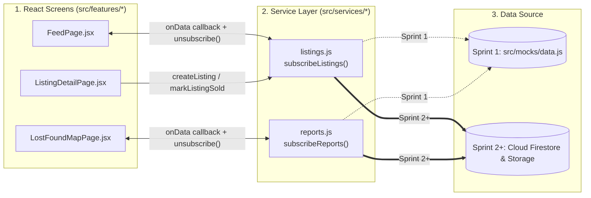
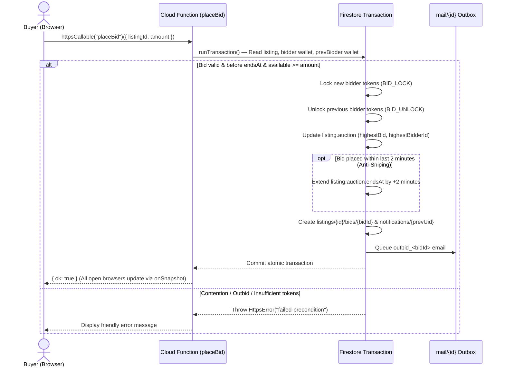
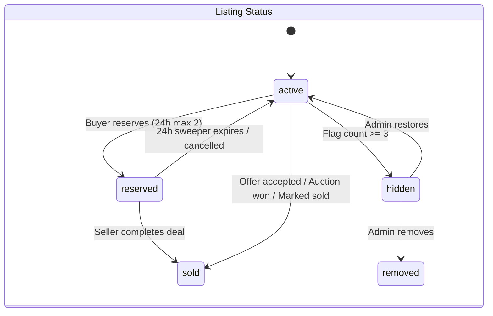

# C.A.C.A — Campus Auction & Claim App

A real-time campus marketplace, token auction house, and geolocated Lost & Found platform built for **Universitatea Politehnica Timișoara (UPT)** students.


---

## 1. Team & Scrum Roles

| Student | Name | Owned Modules & Use Cases |
| :--- | :--- | :--- |
| **Student A** | **Bărbatu Alex** | Marketplace listings (`UC-A1`, `UC-A2`), inverted-index keyword search (`UC-A3`), Lost & Found reports (`UC-A4`), live Leaflet map (`UC-A5`), 24h token boosts (`UC-A6`), public profiles (`UC-S3`), Seed script, GitHub Actions CI & Firebase Hosting deploys |
| **Student B** | **Magu Emanuel-Ionel** | Firebase Auth & route guards (`UC-S1`, `UC-S2`), price/swap offers (`UC-B1`, `UC-B2`), 24h item reservations (`UC-B3`), live token-escrow auctions with anti-sniping & sweeper closing (`UC-B4`, `UC-B5`), 1km geohash report matcher (`UC-B6`) |
| **Student C** | **Pop-Pavalean Spiridon** | Cloud Functions (2nd Gen), Outbox email queue (`mail/{id}`), real-time 1-on-1 chat (`UC-C1`), reviews + 10-token reward (`UC-C2`), Lost & Found claims & bounty handover (`UC-C3`), flagging & auto-hide (`UC-C4`), admin moderation (`UC-C5`), wallet & append-only ledger (`UC-C6`), Stripe Checkout sandbox (`UC-C7`) |

---

## 2. Tech Stack & Pinned Versions (Nov 2026)

* **Runtime & Build**: Node.js `24 LTS` (required for 2nd-gen Cloud Functions), Vite `8.x`, React `19.x`
* **Routing**: React Router `8.x` (**Important**: import everything from `"react-router"`, never `"react-router-dom"`)
* **Styling**: Tailwind CSS `4.x` (`@tailwindcss/vite`)
* **Backend & Emulators**: Firebase JS SDK `13.x`, Firebase CLI `15.x` (requires **Temurin JDK 21**), Firestore Standard (`us-central1`), Cloud Storage, Cloud Functions v2
* **Maps & Geolocation**: Leaflet `1.9.4`, `react-leaflet` `5.x`, `react-leaflet-cluster` `4.x`, `geofire-common`
* **Testing & CI**: Vitest, React Testing Library, `@firebase/rules-unit-testing`, Playwright, GitHub Actions

---

## 3. Repository & Folder Structure

Screens **never** import `firebase/*` directly. All UI components talk to `src/services/*` (Service / Repository pattern), which swaps cleanly from `src/mocks/data.js` in Sprint 1 to Firestore `onSnapshot` listeners in Sprint 2.

```text
SSD_Project/
├── .github/workflows/
│   └── ci.yml                  # Lint, build, unit tests & Firestore rules tests (Student A)
├── .vscode/                    # Shared Prettier format-on-save & extension recommendations
├── functions/src/              # 2nd-Gen Cloud Functions (Node 24)
│   ├── index.js                # Re-exports only (1 line per function)
│   ├── lib/                    # Admin init, wallet/ledger helper, queueEmail() (Student C)
│   ├── users/                  # Welcome email & 100-token signup bonus trigger (Student C)
│   ├── mail/                   # Outbox SMTP sender via Nodemailer (Student C)
│   ├── marketplace/            # Listing boosts (-20 tokens) & bounty locking (Student A)
│   ├── offers/                 # Offer accept/reject & 24h reservations (Student B)
│   ├── auctions/               # Escrow bidding, anti-sniping & auction closing (Student B)
│   ├── lostfound/              # 1km geohash matcher (B) & claim bounty payout (C)
│   ├── payments/               # Stripe Checkout session & signed webhook (Student C)
│   ├── reviews/                # Review rating aggregation & +10 token reward (Student C)
│   ├── moderation/             # 3-flag auto-hide trigger & admin removal (Student C)
│   └── sweeper.js              # Single 2-min scheduled job (auctions, reservations, boosts) (Student B)
├── src/
│   ├── lib/firebase.js         # The ONLY file that initializes Firebase & connects Emulators
│   ├── app/
│   │   ├── Layout.jsx          # Sticky navbar + <Outlet/> shell (Student A)
│   │   └── routes.jsx          # Declarative route table (Student A + B auth guards)
│   ├── components/             # Shared UI primitives (Button, Modal, Spinner, EmptyState) (Student C)
│   ├── hooks/                  # useAuth (B), useWallet (C), useCountdown (B)
│   ├── mocks/data.js           # Sprint 1 fake dataset matching exact Firestore collection fields
│   ├── services/               # Service (Repository) layer — the ONLY browser code importing firebase/*
│   │   ├── listings.js         # Marketplace CRUD, keyword builder & live observer (Student A)
│   │   └── reports.js          # Lost & Found CRUD, geohash generation & live observer (Student A)
│   └── features/               # Isolated feature screens (zero cross-team merge conflicts)
│       ├── marketplace/        # FeedPage, ListingDetailPage, NewListingPage (Student A)
│       ├── map/                # LostFoundMapPage (Student A)
│       ├── lostfound/          # NewReportPage (Student A)
│       ├── profile/            # ProfilePage (Student A)
│       ├── auth/               # Login, Register, RequireAuth, RequireAdmin (Student B)
│       ├── offers/             # OfferDialog, MyOffersPage, ReserveButton (Student B)
│       ├── auctions/           # AuctionPanel, BidBox (Student B)
│       ├── matches/            # PossibleMatchesPanel (Student B)
│       ├── chat/               # ChatList, ConversationPanel (Student C)
│       ├── wallet/             # WalletPage, LedgerTable, BuyTokens (Student C)
│       ├── reviews/            # ReviewModal (Student C)
│       ├── claims/             # ClaimModal, VerifyClaim (Student C)
│       └── admin/              # AdminQueuePage (Student C)
└── .env.example                # Public VITE_FIREBASE_* variable template
```

---

## 4. Architecture & State Diagrams

### 4.1 Service Layer & Observer Pattern


### 4.2 Live Auction Bidding & Token Escrow Sequence (UC-B4)


### 4.3 Contested Object State Machines


---

## 5. Frozen Data Contracts

### `listings/{id}` (Owner: Student A)
* `sellerId`: `string` (`uid` from `useAuth()`)
* `sellerName`: `string`
* `type`: `"fixed" | "swap" | "auction"`
* `title`: `string`
* `description`: `string`
* `category`: `"electronics" | "books" | "clothing" | "accessories" | "keys_ids" | "bikes_gear" | "other"`
* `price`: `number` (in RON; `0` for auctions)
* `photoPaths`: `string[]` (Storage paths or URLs)
* `status`: `"active" | "reserved" | "sold" | "hidden" | "removed"`
* `searchKeywords`: `string[]` (normalised NFD lowercase words)
* `boostedUntil`: `Timestamp | ISO string` (initialized to epoch `new Date(0)` sentinel so `orderBy("boostedUntil", "desc")` includes unboosted listings)
* `flagCount`: `number`
* `createdAt`: `Timestamp | ISO string`
* `auction`: `null | { startPrice, minIncrement, endsAt, highestBid, highestBidderId, status: "open" | "closed", winnerId }`

### `reports/{id}` (Owner: Student A)
* `ownerId`: `string`
* `ownerName`: `string`
* `kind`: `"lost" | "found"`
* `category`: exact string from `CATEGORIES` in `src/mocks/data.js`
* `title`, `description`: `string`
* `eventDate`: `Timestamp | ISO string`
* `lat`, `lng`: `number`
* `geohash`: `string` (computed via `geohashForLocation([lat, lng])`)
* `photoPaths`: `string[]`
* `status`: `"open" | "resolved" | "hidden" | "removed"`
* `bounty`: `number` (tokens)
* `bountyStatus`: `"none" | "locked" | "paid"`

---

## 6. Getting Started (All Teammates)

### Prerequisites
1. **Node.js 24 LTS** (`fnm install 24 && fnm default 24`)
2. **Temurin JDK 21** (`java -version` must be 21+ for Firebase CLI 15 emulators)
3. **Firebase CLI** (`npm install -g firebase-tools`)

### Run Locally
```bash
git clone [https://github.com/5pyr0s/SSD_Project.git](https://github.com/5pyr0s/SSD_Project.git)
cd SSD_Project
cp .env.example .env.local   # Fill in VITE_FIREBASE_* keys from shared vault
npm ci
npm run dev                  # Opens http://localhost:5173
```

### Pre-PR Checks (Must pass before merging to `main`)
```bash
npm run lint
npm run build
npm test -- --run
```